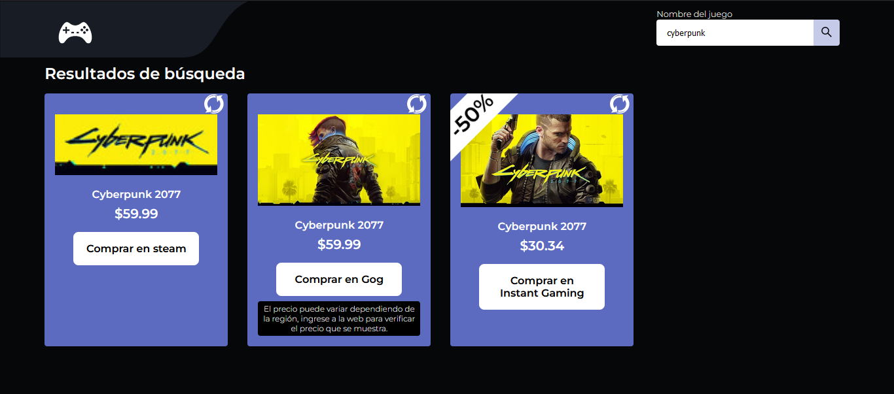
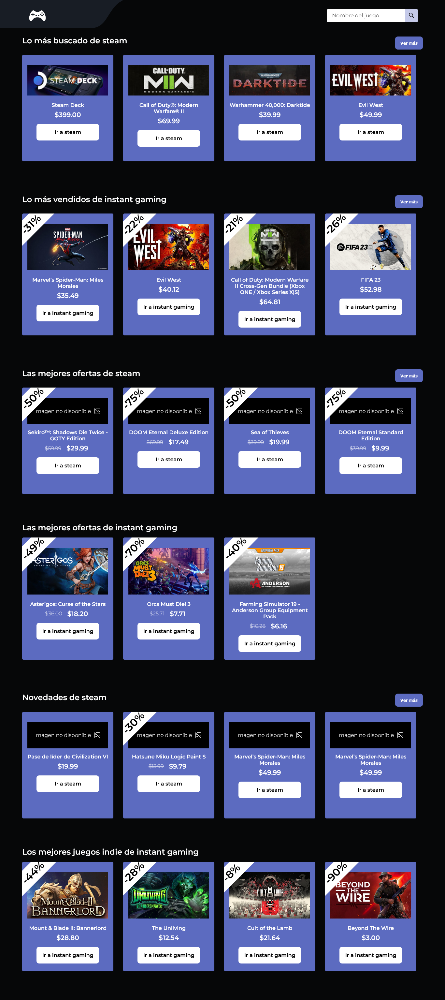

# GameScraping

Compara el precio de un videojuego en Steam, GOG, Instant Gaming, Humble Store y Fanatical. Los datos vienen de la [API de scraping](https://github.com/MarcosRubi/API-gaming-scraping) (NestJS).

Sitio: [games-scraping.mrubi.dev](https://games-scraping.mrubi.dev)

## Capturas

Página inicial

Resultados de búsqueda

Secciones adicionales


## Tecnologías
- [Angular 22](https://angular.dev/): componentes standalone, zoneless, signals y `httpResource`
- [Tailwind CSS 4](https://tailwindcss.com/) para layout y utilidades; SCSS por componente donde las utilidades se vuelven ilegibles (overlays, halos, animaciones del banner)
- Vitest para tests unitarios

## Desarrollo

Requiere Node ≥ 22.22 (o 24 LTS).

```bash
npm install
npm start          # http://localhost:4200 (usa la API en http://localhost:3000)
npm test
npm run build      # dist/gamescraping/browser
```

La URL de la API se define en `src/environments/` (`environment.production.ts` en el build de producción).

## Estructura

```
src/app/
  core/
    models/       tipos (Game, StoreKey...)
    state/        stores con signals: preferencias, tipo de cambio, filtros, búsqueda, datos de la home
    browser/      helpers que convierten eventos del navegador en signals y se limpian solos
    utils/        precios, moneda, dedupe e intercalado de listas (con tests)
  shared/         GameCard, Carousel, InfoNote, StoreTag, Icon
  layout/header/  header, buscador y filtros
  features/       banner destacado, secciones de la home, resultados de búsqueda, modal
```

## Criterios usados

**Cuándo signal y cuándo no**
- `signal`: estado que se pinta (tema, moneda, filtros, índice del banner, panel abierto).
- `computed`: todo lo derivado (secciones agregadas, precio convertido, mejor precio). Nunca un `effect` que escribe otra signal.
- `linkedSignal`: estado local editable que se reinicia cuando cambia su origen (el índice n/m de cada resultado vuelve a 0 con una búsqueda nueva).
- `effect`: solo para sincronizar con algo externo a Angular (localStorage, `data-theme` en `<html>`, timers, scroll).
- Campo normal (no signal): valores transitorios que no se pintan, como el estado de un arrastre en curso.
- `httpResource`: peticiones como signals. Cancela la anterior si cambia el request (sin carreras en la búsqueda) y una tienda fuera del filtro no hace petición.

**Nada corriendo cuando no hace falta**
- Timers del banner y del slideshow: viven en un `effect` con `onCleanup`; se pausan con el mouse encima y cuando la pestaña no está visible.
- Listeners de `document` para cerrar paneles: solo existen mientras el panel está abierto.
- `pointermove`/`pointerup` del carrusel: solo durante el arrastre. `ResizeObserver`: se desconecta al destruir el componente.
- Carruseles por tienda con `@defer (on viewport)`: no se crean (ni se descarga su código) hasta acercarse a la pantalla.
- El tipo de cambio se pide una sola vez si el cacheado tiene más de 12 h; `HttpClient.get` completa solo.

## Docker
```bash
docker build -t gamescraping .
docker run -p 8080:80 gamescraping
```

## Autor
- Portafolio - [Marcos Rubí](https://mrubi.vercel.app/)
